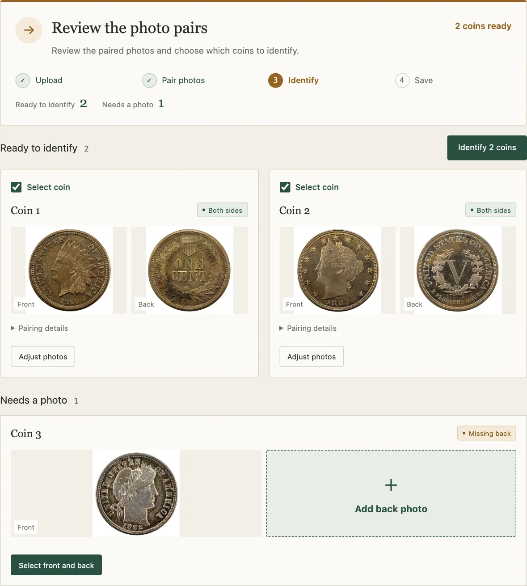
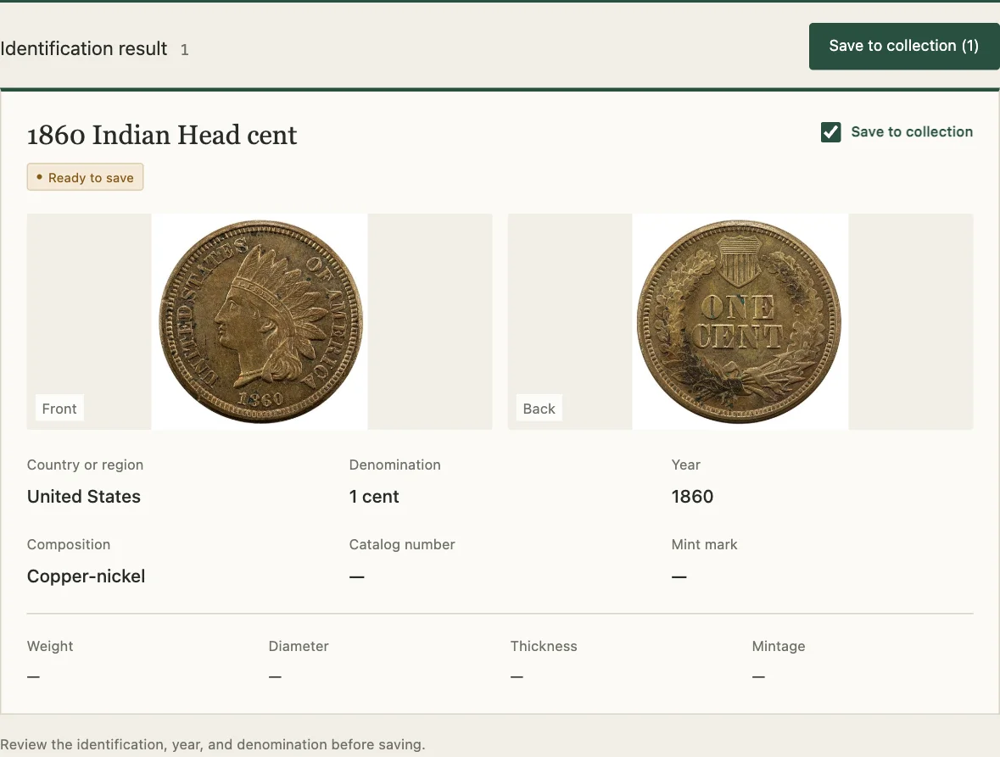

# HeriBase Connector

**將一個資料夾的錢幣相片，整理成可繼續管理的收藏。**

相簿裏有一堆未命名的錢幣相片，或已有一份附圖的試算表？把整批資料交給 Codex、Claude Code 或其他相容的 AI 助手。HeriBase Connector 可協助配對正反面、標示欠缺的相片、辨識你選定的錢幣，並把你核對過的結果加入 HeriBase 收藏。

**[快速上手](#快速上手)** · [HeriBase 官方網站](https://www.heribase.com/zh-HK/) · [更新記錄（英文）](../CHANGELOG.md)

[English](../README.md) · [简体中文](README.zh-CN.md) · **繁體中文** · [日本語](README.ja.md) · [Español](README.es.md) · [Português (Brasil)](README.pt-BR.md) · [Deutsch](README.de.md) · [Français](README.fr.md)

## 5 張相片，整理成 3 枚錢幣的記錄

假設資料夾裏有兩枚錢幣的正反面，第三枚只有正面。助手會整理出兩組完整相片，並提示第三枚欠缺反面。你可先辨識相片齊全的兩枚，稍後補圖再繼續。



*工作台示範使用公開範例相片，畫面以英文呈現。* [示範相片來源](demo-credits.md)

<details>
<summary>看看辨識結果</summary>

確認要辨識的相片後，工作台會顯示建議的幣種和 HeriBase 回傳的資料。對照相片核對年份和面額，再決定是否加入收藏。



*卡片上的辨識資料為示範用途。*

</details>

## 快速上手

把以下指示傳給 Codex、Claude Code，或其他支援 Skills 且能執行本機指令的桌面 Agent：

```text
請從 https://github.com/HeriBase/heribase-ability-skills 安裝全部六個 HeriBase Skills。
依照 README，將整套技能複製到目前 Agent 的 Skills 目錄，再執行 setup.py --init 完成初始化。
準備好後請告訴我如何開始。如需登入 HeriBase，請讓我在瀏覽器完成。
```

<details>
<summary>自行在終端機安裝</summary>

需要 Node.js 24+、Python 3.9+（建議 3.12）和 Git。以下是為 Codex 安裝整套技能的例子：

```sh
npx skills add HeriBase/heribase-ability-skills --skill '*' --agent codex --global --copy
```

使用安裝程式顯示的 Skills 目錄進行初始化。把指令中的 `<skills-dir>` 換成該路徑。

**macOS / Linux**

```sh
python3 "<skills-dir>/heribase-cli/scripts/setup.py" --init
```

**Windows PowerShell**

```powershell
py -3 "<skills-dir>\heribase-cli\scripts\setup.py" --init
```

若使用 Claude Code、Gemini CLI 或 OpenCode，請將 `codex` 換成 `claude-code`、`gemini-cli` 或 `opencode`。只想在目前專案安裝，請移除 `--global`。如果 Agent 找不到技能，可以開啟新對話。

</details>

[安裝及疑難排解（英文）](../docs/installation.md)

## 用自己的相片試試

> 幫我整理這個資料夾的錢幣相片，配對正反面，並列出欠缺或不確定的相片。等我核對後才開始辨識。

## 繼續管理你的收藏

- **接續上次的整理.** 下次可回到同一批資料，找回原始相片、配對決定及核對進度。
- **查看收藏行情.** 查看你在 HeriBase 追蹤的錢幣的最新可用價格。
- **跟進專家鑑定.** 查詢鑑定進度，並在報告完成後查看。

## 使用前須知

- 你可先整理相片，稍後才登入 HeriBase。AI 助手可能透過其服務供應商處理圖片；網上辨識及帳戶操作需要登入 HeriBase。
- 你可以在對話內操作，也可開啟本機工作台核對相片。在工作台上載後自動整理相片，需要已登入的 Codex CLI。
- 辨識結果和參考價格只供研究參考，不能證明真偽或保證成交價。

<details>
<summary>包含的技能</summary>

六個技能共用同一個本機工作空間，請整套安裝。

- [環境設定及登入](../skills/heribase-cli/SKILL.md) · `heribase-cli`
- [儲存及恢復本機工作](../skills/heribase-task-package/SKILL.md) · `heribase-task-package`
- [錢幣整理、辨識及收藏](../skills/heribase-collection/SKILL.md) · `heribase-collection`
- [本機工作台](../skills/heribase-workspace/SKILL.md) · `heribase-workspace`
- [專家鑑定](../skills/heribase-appraisal/SKILL.md) · `heribase-appraisal`
- [行情追蹤](../skills/heribase-tracking/SKILL.md) · `heribase-tracking`

</details>

## 取得協助

[回報問題](https://github.com/HeriBase/heribase-ability-skills/issues). 請勿附上帳戶資料、憑證或私人收藏相片。
